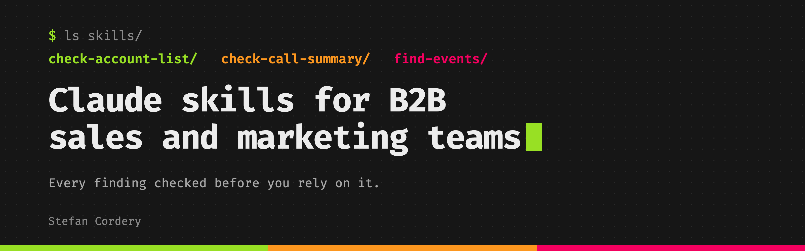

# Skills

[](https://github.com/scordsy/skills/actions/workflows/ci.yml)
[](LICENSE)

Claude skills for B2B sales and marketing teams. Each one does an everyday job, and every finding is checked before you rely on it.

## Why these exist

AI makes everyday sales and marketing jobs fast: a list of target accounts, a summary of a sales call. The output looks right, so it goes straight into the CRM or the outbound sequence. Often it is quietly wrong.

When I asked ChatGPT for "50 companies like our best customer" and checked a sample (15), only 1 was usable. None were made up. They were real companies, just the wrong ones: some had been taken over, some were too big or too small, some sold to a different kind of customer, and some were direct competitors of the company asking for the list.

ChatGPT even told me to check the list before using it: confirm each company's headcount, confirm where it's based, check it actually sells its own software. Good advice. It just didn't do any of it. That checking is the slow, tedious part that gets skipped when you're busy, and it's the part these skills do for you.

Three of the skills here check work you already have: a target account list, an AI summary of a call, or a draft with facts in it. The fourth, find-events, does the research for you: a structured search for the events worth attending to meet the people you want. All four work the same way:

- **It starts from what you give it**: a list, a call transcript, a draft, the people you want to meet.
- **Every finding comes with its source**: a link and the exact words, so you can see why without taking it on trust.
- **The part that does the work never checks it.** A separate checker tries to prove each finding wrong.
- **No API keys and no paid tools.** It runs on Claude's own web search and page reading, so all you need is Claude. Upload it and run it.

## The skills

| Skill | For | What it does |
|---|---|---|
| [**check-account-list**](skills/check-account-list/) | Sales and marketing | Every company on a target account list checked before you spend on it: website, still trading, bought, size, fit and competitors, each with evidence you can click. Checks companies in any country, as far as each country's free register allows. |
| [**check-claims**](skills/check-claims/) | Marketing and sales | Every fact in your article, whitepaper or sales email traced to whoever first published it, before you publish or send it. A statistic the publisher has since replaced, or a case study credited to the wrong company, is flagged with a link and the exact words. |
| [**check-call-summary**](skills/check-call-summary/) | Sales and customer success | An AI summary of a call, checked claim by claim against the transcript before it goes in your CRM. Every claim traced to a quote, with speaker mix-ups, jokes taken literally and missed next steps flagged. |
| [**find-events**](skills/find-events/) | Marketing and sales | A shortlist of events worth attending to meet the people you want, with every event checked against the organiser's own page before you see it. |

## Install

The skills work in Claude.ai in your browser and in the Claude Desktop app, and in Claude Code if you use it.

### Claude.ai and Claude Desktop

Each skill is a zip you upload to your account once. Claude can fetch the zip for you in a chat, and you do the upload yourself.

1. **Turn on Create and edit files**, under **Settings**, then **Capabilities**. In the older Settings layout it is called **Code execution and file creation**. The skills open their own files and run small scripts, so they need it.
2. **Get the zip.** The quick way: paste this page's link, github.com/scordsy/skills, into a chat and say which skill you want. Claude fetches the zip and shows you where to upload it. Or download it yourself: [check-account-list.zip](https://github.com/scordsy/skills/releases/latest/download/check-account-list.zip), [check-call-summary.zip](https://github.com/scordsy/skills/releases/latest/download/check-call-summary.zip), [check-claims.zip](https://github.com/scordsy/skills/releases/latest/download/check-claims.zip) or [find-events.zip](https://github.com/scordsy/skills/releases/latest/download/find-events.zip), all from the [latest release](https://github.com/scordsy/skills/releases/latest).
3. **Upload the zip.** Go to **Customize**, then **Skills**, then **+**, **Create skill**, **Upload a skill**, and choose the zip. If a chat offers to save the skill to your account for you, upload the zip instead. That shortcut keeps only the skill's main file and leaves out the scripts it runs.
4. **Turn on web search** in the chat where you use find-events, check-account-list or check-claims.
5. **Use a normal chat, not an incognito one.** An incognito chat can't open a skill's files, so the skill tells you it can't run there and stops. The one exception is the block find-events, check-account-list and check-claims may ask you to paste into a fresh chat for their check. It carries its own instructions, so an incognito chat is fine for that, and best, because it can't see the chat that did the research.

Then ask Claude for what you need, in your own words: "check this call summary against the transcript before I put it in the CRM".

On a Team or Enterprise plan, your organisation's owner controls **Create and edit files** and can turn off uploading your own skills. If you can't see **Upload a skill**, ask them.

Some Claude.ai and Claude Desktop chats can run subagents, separate helpers that each take one part of the job, as Claude Code does. A skill then runs its full version. A chat that can't gets a version without them, and the skill says what is different. Each skill's own page says which version its tests covered.

New skills and fixes come out as new releases, each with fresh zips.

### Claude Code

```bash
claude plugin marketplace add scordsy/skills
claude plugin install stefancordery-skills@stefancordery
```

Or in one step:

```bash
claude plugin install stefancordery-skills --marketplace scordsy/skills
```

Then run a skill by name, for example `/find-events` (or `/stefancordery-skills:find-events` if another skill shares the name), or just ask Claude for what you need.

**Get new skills as they land.** Plugins from outside Anthropic's own marketplace don't update on their own by default. Turn it on once: `/plugin`, then **Marketplaces**, select **stefancordery**, then **Enable auto-update**. Or update by hand with `claude plugin update stefancordery-skills@stefancordery`.

## About

Built by **Stefan Cordery**. Marketing leader turned builder, 14+ years in B2B marketing, now building GTM systems in Claude Code.

- [Follow me on LinkedIn](https://www.linkedin.com/in/stefancordery/)
- [list-decay](https://github.com/scordsy/list-decay): find the dissolved and closing companies on your UK prospect list before you pay to enrich, verify or email them.

MIT licensed.
